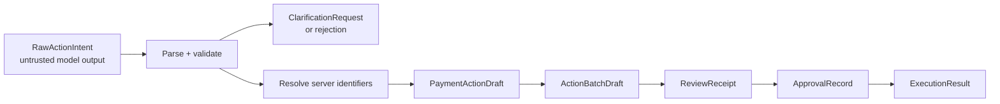

# Action contract shapes

**Status:** planned shared contracts. These shapes define the trust boundary before application code exists. Money is always an integer number of minor units; for SGD, `50000` means S$500.00.

## Contract flow



Only the server creates a resolved draft, receipt, approval record, or execution result.

## 1. `RawActionIntent` — untrusted model proposal

```json
{
  "kind": "BENEFICIARY_TRANSFER",
  "source_account_ref": "savings",
  "recipient_label": "Mum",
  "biller_label": null,
  "destination_account_ref": null,
  "amount_minor": 50000,
  "currency": "SGD",
  "requested_execution_date": null,
  "evidence": {
    "transcript_excerpt": "send Mum 500 dollars from savings"
  }
}
```

Allowed `kind` values are `BILL_PAYMENT`, `BENEFICIARY_TRANSFER`, `INTERNAL_TRANSFER`, and `EQUITY_BUY`. Exactly one destination field is valid for each payment kind. An execution date is `null` for the initial immediate-only demo; scheduled payments are deferred.

The model cannot output a recipient ID, account ID, risk result, approval, receipt digest, or ledger instruction. Its labels are claims that the server must resolve.

For `EQUITY_BUY`, the untrusted proposal has a separate constrained shape:

```json
{
  "kind": "EQUITY_BUY",
  "source_account_ref": "savings",
  "instrument_label": "Apple shares",
  "side": "BUY",
  "allocation": {
    "mode": "REMAINING_AFTER_BATCH",
    "minimum_cash_reserve_minor": 0
  },
  "currency": "SGD"
}
```

`REMAINING_AFTER_BATCH` is an instruction to calculate, never a model-supplied amount. The server uses the resolved earlier actions, current balance, configured reserve, mock-price snapshot, and fractional-share rules to produce a concrete reviewed order. The model cannot choose a price, invent a ticker, or decide that a reserve may be ignored.

## 2. `ClarificationRequest` — safe incomplete outcome

```json
{
  "outcome": "CLARIFICATION_REQUEST",
  "field": "recipient_label",
  "question": "Which saved John do you mean?",
  "candidate_display_names": ["John Tan", "John Lim"]
}
```

The server supplies candidates from accounts and recipients that belong to the authenticated user. The model never invents recipient identifiers.

## 3. `PaymentActionDraft` — server-resolved proposal

```json
{
  "action_id": "server-generated-uuid",
  "kind": "BENEFICIARY_TRANSFER",
  "source_account_id": "acct_savings_01",
  "destination": {
    "beneficiary_id": "beneficiary_mum_01",
    "display_name": "Mum",
    "masked_destination": "•••• 1234"
  },
  "amount_minor": 50000,
  "currency": "SGD",
  "status": "READY_FOR_REVIEW",
  "risk_signals": ["known_recipient"],
  "source_evidence": "send Mum 500 dollars from savings"
}
```

The server creates `action_id`, canonical identifiers, and risk signals after ownership, destination, currency, amount, and policy checks. Possible draft statuses are `NEEDS_CLARIFICATION`, `BLOCKED`, and `READY_FOR_REVIEW`.

For an `EQUITY_BUY`, `destination` is replaced by server-resolved `instrument_id`, display symbol, a price snapshot identifier, permitted investment amount, quantity (including any permitted fractional quantity), and estimated consideration. The receipt binds those values so price or quantity substitution creates a new receipt.

## 4. `ActionBatchDraft` — a planned atomic group

```json
{
  "batch_id": "server-generated-uuid",
  "user_id": "authenticated-user-id",
  "actions": ["resolved-payment-action-drafts"],
  "total_debit_minor": 162000,
  "currency": "SGD",
  "status": "READY_FOR_REVIEW"
}
```

The gateway either applies every action in a batch or applies none. It recalculates totals and available balance rather than trusting these displayed values.

## 5. `ReviewReceipt` — immutable facts awaiting approval

```json
{
  "receipt_id": "server-generated-uuid",
  "batch_id": "server-generated-uuid",
  "user_id": "authenticated-user-id",
  "actions": ["canonical reviewed actions"],
  "total_debit_minor": 162000,
  "currency": "SGD",
  "expires_at": "server-generated-timestamp",
  "nonce": "server-generated-one-time-value",
  "receipt_digest": "server-generated-canonical-hash",
  "status": "AWAITING_APPROVAL"
}
```

The review screen renders this receipt. Any change to amount, recipient, source account, or execution details requires a new receipt and a new approval.

## 6. `ApprovalRecord` — explicit user decision

```json
{
  "approval_id": "server-generated-uuid",
  "receipt_id": "server-generated-uuid",
  "receipt_digest": "hash-shown-to-user",
  "approved_by_user_id": "authenticated-user-id",
  "approved_at": "server-generated-timestamp",
  "status": "APPROVED"
}
```

An approval is bound to an unexpired receipt digest and authenticated user. A client-side Boolean, transcript phrase, or model output is not an approval record.

## 7. `ExecutionResult` — gateway-owned outcome

```json
{
  "execution_id": "server-generated-uuid",
  "receipt_id": "server-generated-uuid",
  "status": "EXECUTED",
  "ledger_transaction_ids": ["ledger-entry-ids"],
  "executed_at": "server-generated-timestamp",
  "idempotency_key": "server-generated-or-client-bound-key"
}
```

The gateway verifies the receipt, approval, nonce, expiry, ownership, policy, current balance, and idempotency immediately before an atomic mock-ledger write. It returns a failed result rather than partial execution.

## Where these will live

Once implementation begins, language-neutral schemas should live in `packages/contracts/` and be validated by both the web app and gateway. The gateway remains the authority even when a client validates the same schema.
