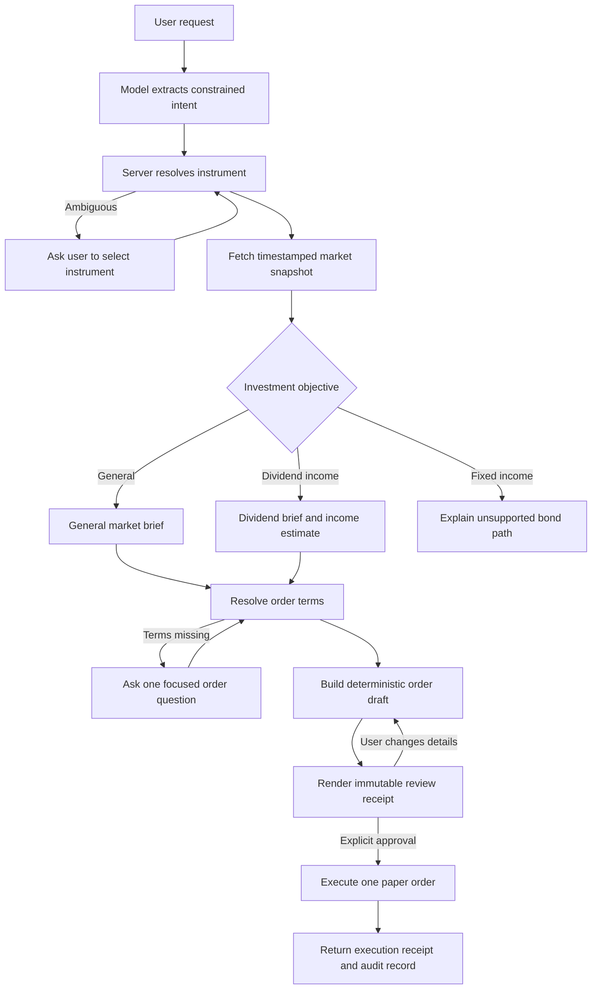
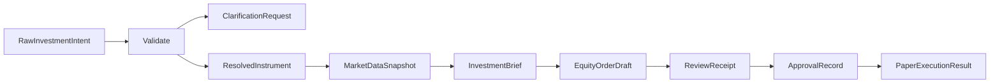

# Dimon stock acquisition contracts

**Status:** Living design and implementation tracker
**Primary user:** Persona 0, the founder-trader
**Initial instruments:** US-listed equities, beginning with Nasdaq and NYSE
**Initial data adapter:** A repository-owned Python adapter built with `yfinance`

## Working now

Use this section as the active workbench. Everything below it is reference material until the current slice works.

### Current slice

User says:

> I want to invest $2,000 in Cognizant Technology Solutions.

The same route also accepts natural spoken phrasing such as:

> I want to put two thousand dollars into NVIDIA.

### User intention phrases to support

Start with these two ways of expressing the same allocation-first intention:

1. [x] “I want to put $2,000 into NVIDIA.”
2. [x] “I have allocated $2,000, and I feel like investing it in NVIDIA.”

Both statements request research and position sizing. Neither statement authorizes an order. Dimon must resolve NVIDIA, prepare the stock brief, check available funds, and ask for the missing order instruction.

Dimon must:

1. Resolve the company name to Cognizant Technology Solutions Corporation, `CTSH`, on Nasdaq.
2. Fetch one timestamped market snapshot through the local `yfinance` adapter.
3. Return the current price, market state, trailing P/E ratio, past-two-week high and low, one useful position percentage, and the price change from one year ago.
4. Interpret a bare `$` as the instrument's quote currency and state that assumption without asking another question.
5. Calculate how many whole shares fit inside the allocation, estimated spend, and cash left over. Show an indicative FX conversion when the funding and quote currencies differ.
6. Compare the estimated funding requirement with the user's sole SGD funding account.
7. If funds are sufficient, ask “Buy now at market, or set a maximum price?” When the market is closed, say the market order would wait until it reopens. If funds are insufficient, show the shortfall and ask “Lower the amount?”

The research brief is the first response slice. The generic conversation layer now accepts follow-up order terms and stops at `READY_FOR_DRAFT`; it still does not create or execute an order.

### Contracts needed now

Define only these four contracts, then implement the slice end to end:

| Contract | Minimum responsibility |
| --- | --- |
| `RawInvestmentIntent` | Preserve the instrument label, $2,000 allocation, currency context, and general investment objective |
| `ResolvedInstrument` | Hold the server-verified company name, symbol, exchange, instrument type, and quote currency |
| `MarketDataSnapshot` | Hold the timestamped price, market state, trailing P/E, two-week range, and one-year comparison from the provider |
| `InvestmentBrief` | Hold the verified facts, currency interpretation, optional FX estimate, whole-share calculation, unallocated cash, warnings, and next question |

Do not define every future stock, dividend, bond, or broker contract first. Add a contract when the next working conversation needs it.

### Price context

Use natural time periods in the response. “Past two weeks” means the 14 calendar days ending at the snapshot time. Calculate the range from every market session in that window. Include the current session's high and low when the provider supplies them.

```text
two-week high = maximum daily high in the 14-day window
two-week low = minimum daily low in the 14-day window
percent below high = (high - current price) / high × 100
percent above low = (current price - low) / low × 100
one-year change = (current price - comparison close) / comparison close × 100
```

For the one-year comparison, use the closing price from the same calendar date one year earlier or the nearest preceding market session. Say “up” or “down from one year ago.” Do not call the stock depressed or elevated based on this number alone.

Show the two-week high and low, then speak only the more useful nearby-boundary percentage. For example, say “6.3% below the two-week high” instead of also saying “5.3% above the low.” The screen may show both percentages.

### Currency policy

Avoid a clarification turn for a bare dollar sign:

1. Explicit `USD`, `US$`, `SGD`, or `S$` always wins.
2. A bare `$` uses the resolved instrument's quote currency. `$2,000 in CTSH` means USD 2,000; `$2,000 in DBS` means SGD 2,000.
3. Dimon states the assumption: “I’m treating $2,000 as US$2,000 because CTSH trades in USD.”
4. When the funding account uses another currency, Dimon speaks the indicative conversion without reading provider metadata aloud.
5. The user can correct the assumption in one phrase, such as “Use S$2,000 instead.” Dimon then rebuilds the calculation.

The FX estimate retains the pair, rate, timestamp, source, converted amount, and warning in the API payload. The conversational response and visible stock card omit the timestamp, provider name, and warning. Keep the estimate nested inside `InvestmentBrief` for this slice rather than creating another top-level transaction contract.

### Response shape

Dimon should say, for example:

> CTSH is US$60.00. Nasdaq is open. P/E: 9.0x. Two-week range: US$57.00–US$64.00; it's 5.3% above the low. It's down 20.0% over one year. I treated your $2,000 as USD. That allocation is about S$2,560.00 and buys 33 whole shares for US$1,980.00, leaving US$20.00. Your savings balance is S$1,000.00, so you're short S$1,560.00. Lower the amount?

Those numbers illustrate the response shape. Tests must use provider fixtures; the model must not supply any of them.

If the user already supplied complete order terms, replace the final question with the immutable order summary and approval request. Never say that a trade will be placed merely because the user expressed investment interest.

### Immediate implementation order

- [x] Create the four Python contract models.
- [x] Add and lock `yfinance` 1.7.0.
- [x] Implement `CTSH` and company-name resolution, including primary-listing preference over foreign cross-listings.
- [x] Implement the market snapshot, two-week range, and one-year comparison.
- [x] Implement currency interpretation and indicative FX conversion.
- [x] Build the investment brief and whole-share calculation.
- [x] Check the SGD funding account and show a deterministic shortfall when it cannot cover the allocation.
- [x] Connect the slice to `POST /api/actions` and the existing speech-result path.
- [x] Add fixtures, service/API tests, and a rendered-card test for the CTSH example.
- [x] Distill the spoken and visible brief by hiding snapshot/provider metadata while retaining it in the API payload.
- [x] Accept spoken dollar amounts and “put … into …” phrasing; verify that NVIDIA resolves dynamically to `NVDA` without invoking the language model.
- [x] Lock manual form submission while an automatic voice request is starting, listening, or transcribing.

### Implemented response flow

The initial request now works as one complete, non-executing turn:

```text
voice or typed request
  -> POST /api/actions
  -> bounded Qwen stock-intent extractor (local mode)
  -> grounded company/ticker mention
  -> deterministic parser fallback when Qwen is unavailable
  -> Yahoo instrument search and primary-listing resolution
  -> timestamped quote, history, and FX retrieval
  -> deterministic calculations
  -> ANSWERED / REAL_STOCK_BRIEF
  -> screen card plus spoken answer
```

No investment order is created by this flow. Qwen supplies only a grounded language
interpretation; Yahoo Finance supplies the canonical instrument and market facts, and
deterministic code performs all calculations and policy checks.

### Dynamic instrument universe and new IPOs

The old fictional catalog is not the source of truth for a real-stock request. It remains available only for the legacy synthetic investment demo. A real-stock request follows this bounded route:

```text
natural-language company or ticker
  -> Qwen extracts the user's instrument wording (not a ticker or market fact)
  -> grounded evidence check
  -> deterministic parser fallback
  -> yfinance.Search candidate discovery
  -> supported exchange + EQUITY validation
  -> dominant-candidate check
  -> verified quote and company metadata
```

This means Dimon does not need a code change whenever a supported exchange lists a new IPO. It becomes discoverable when the market-data provider publishes it. If the provider has not indexed it yet, or two candidates are too close, Dimon must not guess: it asks for the ticker or reports that verified market data is not available yet.

Do not use general web search as the authority for ticker selection, order sizing, or execution. News/web search can later enrich a research brief, but a supported market-data or broker adapter must verify every execution-critical symbol and price.

### Implemented now: conversational order follow-up

DIMON now binds a later typed, button, or voice utterance such as “buy it now” or “five percent below market, GTC” to the preceding real-stock brief. The existing `POST /api/clarifications/{clarification_id}/respond` contract remains specialized for payment amounts; the investment flow uses the generic server-owned conversation core.

The generic `conversation_threads` and `conversation_turns` tables preserve the resolved symbol, allocation, currency interpretation, snapshot facts, expiry, and still-missing order fields. The HTTP and voice follow-up paths use the same transition service:

1. Resolve “buy it now” to a market-order draft using the pending CTSH context.
2. Resolve “five percent below market” to a calculated limit price, then ask for `DAY` or `GTC` only when needed.
3. Keep currency/allocation repair extensible; the current adapter supports using the available balance and leaves account switching for the next adapter slice.
4. Refuse expired, cross-session, stale-version, or terminal context.
5. Stop at `READY_FOR_DRAFT`; receipt creation, Singpass/face/device approval, and paper execution remain a later milestone.

The current contracts are:

| Endpoint | Purpose |
| --- | --- |
| `POST /api/actions` | Start a real-stock conversation and return the verified brief plus public conversation envelope. |
| `GET /api/conversations/{conversation_id}` | Resume a session-scoped conversation without synthesizing audio. |
| `POST /api/conversations/{conversation_id}/turns` | Apply one strict `TEXT` or `CHOICE` turn with `expected_version` and an idempotent `request_id`. |
| `/api/voice/session?conversation_id=...&expected_version=...` | Route one transcribed voice turn through the same transition service. |

Set `DIMON_CONVERSATIONS_ENABLED=0` to disable only this optional subsystem. Existing payment, clarification, and one-turn action routes continue to operate.

Do not store this context only in browser JavaScript. Voice, typed input, retry, and public/local clients must all observe the same server-owned state.

### Name-resolution spike: 2026-10-03

This was the pre-implementation spike using `yfinance` 1.7.0 with fuzzy search enabled. The dependency and repository-owned adapter are now integrated into Dimon.

| User phrase | First equity candidate | Symbol | Result |
| --- | --- | --- | --- |
| Broadcom | Broadcom Inc. | `AVGO` | Correct primary US listing |
| SpaceX | Space Exploration Technologies Corp. | `SPCX` | Correct current Nasdaq listing |
| SLAM Research | Lam Research Corporation | `LRCX` | Corrected the spoken or typed near-match |
| DBS | DBS Group Holdings Ltd | `D05.SI` | Correct SGX listing |
| Singapore Airlines | Singapore Airlines Limited | `C6L.SI` | Correct SGX listing |
| OCBC | Oversea-Chinese Banking Corporation Limited | `O39.SI` | Correct SGX listing |
| UOB | United Overseas Bank Limited | `U11.SI` | Correct SGX listing |
| Marvel Technology | Marvell Technology, Inc. | `MRVL` | Corrected the misspelling |

Nasdaq identifies Space Exploration Technologies Corporation as `SPCX` in its [June 26, 2026 index announcement](https://ir.nasdaq.com/node/110646/pdf). The resolver must use current evidence instead of a stored assumption that SpaceX is private.

The same run fetched these market facts at `2026-10-03T15:39:19Z`. Both US and Singapore markets reported `CLOSED`.

| Symbol | Currency | Price returned | Trailing P/E |
| --- | --- | ---: | ---: |
| `AVGO` | USD | 355.14 | 43.84x |
| `SPCX` | USD | 158.96 | Unavailable |
| `LRCX` | USD | 347.49 | 59.20x |
| `D05.SI` | SGD | 77.21 | 19.75x |
| `C6L.SI` | SGD | 6.66 | 22.20x |
| `O39.SI` | SGD | 31.66 | 18.20x |
| `U11.SI` | SGD | 43.11 | 14.97x |
| `MRVL` | USD | 272.29 | 90.16x |

These values prove that the fields are retrievable. They are time-sensitive Yahoo research data, not fixed test expectations or executable quotes.

### Resolver rule from the spike

Use `yfinance.Search` to generate candidates. Dimon then validates the selected candidate:

1. Require the intended instrument type, initially `EQUITY`.
2. Prefer supported primary exchanges and the user's market context.
3. Compare the requested name with the returned long and short names.
4. Verify symbol, exchange, quote currency, and company metadata.
5. Resolve automatically only when one candidate is clearly dominant; otherwise ask the user to choose.

`yfinance` supplies candidates and facts. Dimon owns the resolution decision and audit evidence.

### Parked until this slice passes

- Dividend-specific briefs
- Limit-order and market-order receipts
- `DAY` and `GTC`
- Paper execution
- SGX conventions
- Project Holo and Reddit sentiment
- Bonds and funds

## Purpose

Dimon should turn an ordinary investment request into a grounded market brief and a reviewable paper order. The first version follows the founder-trader's real workflow. Later versions can add other personas without weakening the transaction boundary.

This document serves four jobs:

1. Record the desired conversation.
2. Define the contracts between the model and deterministic Python.
3. Track implementation and tests.
4. Hold later ideas without pulling them into the MVP.

## Decisions recorded so far

- Use **Dimon** as the product and assistant name.
- Build for Persona 0 first, then test the workflow with contrasting investor personas.
- Reimplement the required market-data logic inside this repository.
- Use the separate sibling `stocksh` project as reference code only. Dimon must not import it, call it, read its database, or require it at runtime.
- Use real SGX, Nasdaq, and NYSE instruments rather than invented companies. Start the implementation with US equities, then add SGX conventions.
- Use `yfinance` for the first market-data adapter.
- Treat Yahoo-derived prices as research snapshots, not executable broker quotes.
- Keep Project Holo and Reddit sentiment outside the synchronous MVP path.
- Support market and limit orders.
- Interpret “buy it now” as a market-order instruction.
- If the user supplies an allocation without an entry price, ask for the price or order type.
- Accept relative instructions such as “place a limit order 5% below the market.”
- Let the user select time-in-force, including `DAY` and `GTC`.
- Use whole shares only in the first MVP.
- Interpret a bare `$` in the resolved instrument's quote currency and state the assumption instead of asking a currency question.
- Show the calculated quantity and estimated consideration before approval.
- Require a new confirmation whenever price, quantity, symbol, order type, or time-in-force changes.

## Product boundary

The language model may extract labels and explain verified facts. Deterministic Python resolves instruments, fetches market data, performs money calculations, applies order rules, produces receipts, and executes paper orders.

The model must not:

- invent a symbol, quote, P/E ratio, dividend figure, earnings date, or headline;
- select a limit price that the user did not provide or accept;
- treat “I am interested” or “I want to invest” as final approval;
- convert a research snapshot into an executable quote;
- submit an order because the user approved an earlier version of it.

## The three layers of an investment request

| Layer | Examples | Effect |
| --- | --- | --- |
| Investment objective | “I want to invest in CTSH”; “I want to acquire it for dividends” | Chooses the research brief and relevant follow-up questions |
| Order instructions | “Use $2,000”; “5% below market”; “GTC”; “buy it now” | Determines allocation, quantity, order type, price, and time-in-force |
| Execution approval | “Confirm this order” against a displayed receipt | Authorizes one exact, unexpired paper order |

The user can provide all three layers in one turn, but Dimon still renders the exact order receipt before execution.

## Investment objectives

### General acquisition

Example:

> I would like to invest $2,000 in Cognizant Technology Solutions today.

Dimon resolves the company to `CTSH`, prepares a general market brief, sizes the position, and asks for the missing order terms.

### Dividend income

Example:

> I want to acquire CTSH for the dividends. Allocate $2,000.

Dimon adds income-oriented facts and calculations:

- trailing and forward dividend yield, labeled separately when available;
- indicated annual dividend per share;
- payment frequency;
- latest declared dividend;
- next ex-dividend and payment dates when available;
- payout ratio and dividend growth history when the provider supplies them;
- dividend cuts, suspensions, or irregular payments visible in the available history;
- estimated annual cash income for the proposed quantity;
- the data timestamp and any missing fields.

Dimon must describe dividend income as an estimate. A company can change or cancel a dividend. Dimon must not promise eligibility from the ex-dividend date alone.

### Bonds and income funds

The objective vocabulary should allow `FIXED_INCOME`, but direct bond acquisition remains outside the first equity MVP. Individual bonds need different identifiers, price conventions, accrued interest, yield-to-maturity calculations, maturity dates, call provisions, and liquidity warnings. Bond ETFs can use the fund path once Dimon supports fund-specific fields.

## Persona 0 conversation contract

### 1. General investment request with missing order terms

User:

> Hey Dimon, I would like to invest $2,000 in Cognizant Technology Solutions today.

Illustrative response shape:

> Cognizant Technology Solutions Corporation resolves to CTSH on Nasdaq. It is trading around US$60.00 as of 10:42 AM ET, and the market is open. Its trailing P/E is 9.0x. Over the past two weeks, it traded between US$57.00 and US$64.00, and it is down 20% from one year ago. Its next earnings announcement is expected on [date].
>
> At $60.00, a $2,000 allocation can acquire up to 33 whole shares for an estimated $1,980, leaving about $20 unallocated.
>
> What is the highest price you want to pay, or should I prepare a market order?

Every number above is illustrative. Production responses must use one timestamped snapshot and must omit unavailable values rather than fill them with model guesses.

### 2. Explicit market order

User:

> Buy it now.

Dimon interprets this as `MARKET`, calculates an estimated quantity from the latest snapshot, and displays a final receipt. The receipt explains that the fill price and total can change.

An allocation is a target unless the broker supports a notional order with a hard cap. A share-quantity market order can exceed the target when the price moves. The MVP must disclose this before approval.

### 3. Relative limit order

User:

> I want to invest $2,000 in CTSH. Place a limit buy order 5% below the market, good till cancelled.

Given a verified reference price of `$60.00`, deterministic Python calculates:

```text
raw limit price = 60.00 × (1 - 0.05) = 57.00
whole-share quantity = floor(2,000.00 / 57.00) = 35
estimated consideration = 35 × 57.00 = 1,995.00
estimated unallocated cash = 2,000.00 - 1,995.00 = 5.00
```

Dimon then presents an exact receipt:

> Prepare a GTC limit buy for 35 shares of CTSH at no more than $57.00 per share. Maximum consideration is $1,995 before fees, leaving at least $5 from the allocation. The $57.00 limit is 5% below the $60.00 reference quote captured at [timestamp]. This order may remain unfilled. Confirm this exact paper order?

For a buy order, Dimon rounds a relative limit price down to the instrument's valid tick size. It records the source price and timestamp so a later market move does not silently alter the order.

### 4. Dividend-oriented request

User:

> I want to acquire this for dividends. Put $2,000 into it.

Illustrative response shape:

> CTSH currently pays an indicated annual dividend of [amount] per share, equal to a [yield]% forward yield at the current reference price. It normally pays [frequency]. The next reported ex-dividend date is [date], and the next payment date is [date or unavailable].
>
> At the current reference price, your allocation can acquire [quantity] whole shares. At the indicated rate, that position would generate about [estimated annual income] per year before tax, fees, currency conversion, or future dividend changes.
>
> What is the highest price you want to pay, or should I prepare a market order?

The dividend objective changes the brief. It does not change the confirmation or execution rules.

## Conversation flow



## Contract flow



Only server-owned code creates resolved instruments, data snapshots, order drafts, receipts, approvals, and execution results.

## Proposed contract shapes

These shapes will evolve as implementation exposes constraints. Money and prices use integer minor units or decimal strings. Python calculations use `Decimal`, never binary floating point.

### `RawInvestmentIntent`

Untrusted model output:

```json
{
  "kind": "EQUITY_BUY",
  "instrument_label": "Cognizant Technology Solutions",
  "objective": "GENERAL_ACQUISITION",
  "allocation": {
    "amount_minor": 200000,
    "currency": "USD"
  },
  "requested_execution": "TODAY",
  "order_terms": {
    "order_type": "UNSPECIFIED",
    "limit_price": null,
    "relative_limit_percent_below_market": null,
    "time_in_force": "UNSPECIFIED"
  },
  "evidence": {
    "transcript_excerpt": "invest two thousand dollars in Cognizant Technology today"
  }
}
```

Allowed initial `objective` values:

- `GENERAL_ACQUISITION`
- `DIVIDEND_INCOME`
- `CAPITAL_GROWTH`
- `SHORT_TERM_TRADE`
- `UNSPECIFIED`

`FIXED_INCOME` belongs in the vocabulary but returns an unsupported-instrument outcome until the bond contract exists.

The model preserves whether the user supplied an explicit currency or a bare `$`. After resolving the instrument, server code interprets a bare `$` in the quote currency and records that assumption. It asks only when the instrument's quote currency cannot be established.

### `ResolvedInstrument`

```json
{
  "instrument_id": "server-owned-id",
  "symbol": "CTSH",
  "name": "Cognizant Technology Solutions Corporation",
  "instrument_type": "EQUITY",
  "exchange": "NASDAQ",
  "quote_currency": "USD",
  "provider_symbol": "CTSH",
  "resolution_status": "EXACT",
  "resolution_evidence": "provider search and exchange metadata"
}
```

If “Cognizant technology” produces multiple plausible instruments, Dimon returns candidates instead of selecting one through model confidence alone.

### `MarketDataSnapshot`

```json
{
  "snapshot_id": "server-generated-uuid",
  "instrument_id": "server-owned-id",
  "provider": "YFINANCE",
  "captured_at": "server-timestamp",
  "market_state": "REGULAR",
  "is_executable_quote": false,
  "price": "60.00",
  "currency": "USD",
  "day_low": "59.10",
  "day_high": "61.20",
  "week_52_low": "50.00",
  "week_52_high": "66.67",
  "percent_above_52_week_low": "20.00",
  "percent_below_52_week_high": "10.00",
  "trailing_pe": "9.00",
  "forward_pe": null,
  "next_earnings_at": null,
  "next_earnings_is_estimated": true,
  "data_warnings": []
}
```

The snapshot also carries optional dividend facts and a bounded set of attributed headlines. Missing provider values remain `null`.

### `EquityOrderDraft`

```json
{
  "order_id": "server-generated-uuid",
  "instrument_id": "server-owned-id",
  "side": "BUY",
  "quantity": "35",
  "allows_fractional_quantity": false,
  "order_type": "LIMIT",
  "limit_price": "57.00",
  "time_in_force": "GTC",
  "allocation": "2000.00",
  "estimated_consideration": "1995.00",
  "estimated_unallocated_cash": "5.00",
  "currency": "USD",
  "reference_snapshot_id": "server-generated-uuid",
  "relative_price_instruction": {
    "percent_below_market": "5.00",
    "reference_price": "60.00"
  },
  "status": "READY_FOR_REVIEW"
}
```

The draft uses `NEEDS_CLARIFICATION` until it has a resolved instrument, positive allocation, order type, quantity, supported time-in-force, and limit price when required.

### `ReviewReceipt`

The existing receipt-bound approval design remains in force. The stock receipt binds at least:

- authenticated user and account;
- instrument ID, symbol, exchange, and quote currency;
- side and quantity;
- order type, limit price, and time-in-force;
- allocation and estimated or maximum consideration;
- reference snapshot ID and timestamp;
- fees or an explicit statement that the paper MVP excludes them;
- expiry, nonce, version, and canonical digest.

Changing any bound value creates a new receipt and invalidates the earlier approval.

## Deterministic calculations

For a verified price `P`, allocation `A`, and whole-share trading:

```text
percent below 52-week high = (52w high - P) / 52w high × 100
percent above 52-week low  = (P - 52w low) / 52w low × 100
relative buy limit         = P × (1 - requested percent / 100)
whole-share quantity       = floor(A / applicable order price)
estimated consideration    = quantity × applicable order price
estimated annual dividend  = quantity × indicated annual dividend per share
```

The order builder applies exchange tick-size rules after calculating the raw limit. It recalculates quantity after rounding.

Market orders use the latest research price only for an estimate. The paper execution engine records its simulated fill separately. A future broker adapter must replace the research price with a broker quote at review and execution time.

## Market brief policy

### General brief

Keep the spoken response short enough to follow. Present:

1. Resolved company, symbol, and exchange.
2. Current price, currency, market state, and timestamp.
3. Trailing and forward P/E when available.
4. Past-two-week range context and change from one year ago.
5. Next earnings event and one material recent headline when available.
6. Quantity and remaining allocation.
7. One question for the missing order term.

The screen can display more fields than the voice response.

### Dividend brief

Lead with the indicated yield, annual dividend per share, schedule, ex-dividend date, and estimated income for the proposed quantity. Keep valuation and 52-week context visible but secondary.

### News

The MVP may show a small provider-supplied news list with title, publisher, publication time, and URL. A model summary must cite those items and must not claim that a headline caused a price movement. Project Holo will provide deeper analysis in a later phase.

## Local implementation architecture

Dimon will own the new code. A likely package layout is:

```text
apps/dimon_live/markets/
├── models.py                 # validated market and order contracts
├── provider.py               # provider protocol
├── yfinance_provider.py      # Yahoo/yfinance adapter
├── instrument_resolver.py    # company name and ticker resolution
├── market_brief.py           # objective-aware verified facts
├── order_builder.py          # Decimal math and order validation
├── dividend_brief.py         # dividend fields and income estimate
└── paper_broker.py           # deterministic simulated execution
```

The application should keep the existing action lifecycle:

- `POST /api/actions` accepts the natural-language intention.
- `POST /api/clarifications/{clarification_id}/respond` supplies missing instrument or order terms.
- `POST /api/receipts/{receipt_id}/approve` approves one immutable stock receipt.

The implementation may add read-only market endpoints if the UI needs refreshes, but the conversational flow should not require the browser to assemble trusted order fields.

## Stocksh reference map

The reference project file `stocksh/go/internal/price/yahoo.go` demonstrates useful behavior:

- combines current-session data with historical chart data;
- exposes regular, pre-market, and post-market prices;
- captures market state, day range, and 52-week range;
- calculates the percentage below the 14-session closing high;
- calculates RSI and average volume;
- fetches the next earnings date and labels estimated dates;
- records before-market and after-market earnings timing.

Dimon should reproduce only the behavior selected for this product. It should use Python contracts and tests suited to this repository. The first implementation does not need RSI or Reddit sentiment.

## Implementation tracker

### Available in the repository

- [x] FastAPI application and browser UI.
- [x] Natural-language action endpoint.
- [x] Clarification lifecycle.
- [x] Receipt-bound approval endpoints.
- [x] Deterministic policy and SQLite mutation boundary for synthetic banking actions.
- [x] Typed and voice request paths.
- [x] Separation between model proposals and server-owned execution.

### Design agreed

- [x] Persona 0 first.
- [x] General and dividend-income objectives.
- [x] Company-name-to-symbol resolution requirement.
- [x] Market and limit order semantics.
- [x] Relative limit price instructions.
- [x] `DAY` and `GTC` time-in-force choices.
- [x] Whole shares only for the first MVP.
- [x] Quantity and unallocated-cash calculation.
- [x] Stocksh as a reference with no runtime dependency.
- [x] Project Holo and Reddit analysis deferred from the synchronous MVP.

### Remaining roadmap

- [x] Add a Yahoo Finance provider boundary (runtime dependency remains optional for offline fixtures).
- [x] Create repository-owned market contracts.
- [x] Implement instrument search and ambiguity handling.
- [x] Implement timestamped market snapshots.
- [x] Add P/E, two-week range, one-year comparison, and FX fields.
- [x] Add objective extraction to the constrained stock-intent model contract.
- [x] Implement Decimal-based allocation and quantity calculations.
- [x] Implement market, absolute-limit, and relative-limit order drafts.
- [x] Implement `DAY` and `GTC` validation.
- [x] Extend paper receipts to bind stock order details.
- [x] Implement isolated paper execution and exactly-once cash/holdings writes.
- [x] Add stock-focused UI states and spoken responses.
- [x] Add deterministic fixtures for offline tests and judge demos.
- [ ] Add dividend-income fields and annual-income estimates.
- [ ] Add live broker execution (explicitly outside this MVP).

## Proposed implementation order

### Phase 1: Verified market brief

1. Add market contracts and a provider protocol.
2. Add the local `yfinance` adapter.
3. Resolve `CTSH` and “Cognizant Technology Solutions” to the same instrument.
4. Return price, market state, P/E, two-week range, one-year comparison, and next earnings.
5. Record provider, timestamp, missing fields, and staleness.

### Phase 2: Order drafting

1. Extend the action intent with allocation and order terms.
2. Ask for price or market order when the user provides only an allocation.
3. Build market, fixed-limit, and percentage-below-market drafts.
4. Calculate whole-share quantity and unallocated cash.
5. Bind the exact draft to the receipt and approval flow.

### Phase 3: Dividend objective

1. Extract `DIVIDEND_INCOME` from natural language.
2. Fetch and validate dividend fields.
3. Estimate annual income for the proposed quantity.
4. Tailor the spoken and displayed brief.
5. Test missing, irregular, suspended, and zero-dividend cases.

### Phase 4: Paper execution and demo polish

1. Execute an approved order against a deterministic paper broker.
2. Persist the order, simulated fill, and audit trail.
3. Add offline fixtures for repeatable judge demonstrations.
4. Show clearly whether data is live, delayed, cached, or recorded.

### Phase 5: More markets and instruments

1. Add SGX symbols and Singapore market conventions.
2. Add fund-specific fields and dividend-income ETFs.
3. Design a separate direct-bond contract.
4. Add a broker adapter only after the paper boundary is proven.

## Acceptance scenarios

| Request | Expected result |
| --- | --- |
| “Invest $2,000 in Cognizant Technology today” | Resolve CTSH, show general brief and quantity estimate, then ask for market or maximum price |
| “Buy it now” after the CTSH brief | Create a market-order receipt with price-movement disclosure |
| “Put $2,000 into CTSH at $59, GTC” | Calculate whole shares at $59 and show an immutable limit-order receipt |
| “Buy CTSH 5% below market with $2,000” | Bind the timestamped reference price, calculate limit and quantity, then request confirmation |
| “Acquire CTSH for dividends with $2,000” | Show dividend brief and estimated income, then ask for order terms |
| “Buy Cognizant” when resolution is ambiguous | Show candidates and create no order |
| “Skip confirmation and buy it” | Refuse the bypass and create no execution |
| Quote changes after receipt creation | Require a new receipt if a bound order field changes |
| Yahoo data is unavailable | Return a bounded unavailable state; do not invent a brief or order price |
| Repeat approval for an executed order | Reject the replay and create no second order |

## Open decisions

- When the user gives a market order with a strict allocation, should Dimon reduce quantity using a configurable price buffer or require a marketable limit order?
- Should `DAY` or `GTC` be Persona 0's default for a limit order when the user omits time-in-force?
- How recent must a quote be before Dimon refreshes the receipt?
- Which dividend history fields can the chosen provider supply with stable semantics?
- Should the first demo include provider headlines or only earnings-calendar events?
- Which simulated fill rule will the paper broker use for market and limit orders?

## Moonshot backlog

These ideas remain outside the first synchronous path:

- Run Project Holo in the background while Dimon speaks the basic market brief.
- Stream the Holo conclusion into the same conversation when it finishes.
- Add Reddit sentiment with source links, recency, sample size, and manipulation warnings.
- Compare valuation and dividend metrics with sector peers.
- Screen for dividend kings, aristocrats, yield thresholds, and dividend growth.
- Track dividend calendars and expected portfolio income.
- Model dividend reinvestment and compounding scenarios.
- Detect concentration risk against the user's existing portfolio.
- Explain currency exposure for a Singapore investor buying USD assets.
- Support SGX equities, REITs, bonds, bond ETFs, options, and multi-leg orders.
- Add earnings-call and filing summaries.
- Add tax-lot, withholding-tax, and fee estimates.
- Connect a real broker through the same receipt-bound execution boundary.
- Learn Persona 0 preferences for whole shares, time-in-force, order style, and response depth without skipping approval.

## Change log

- **2026-10-04:** Chose quote-currency interpretation for a bare `$`, added optional indicative FX conversion, changed the short range to the past 14 calendar days, and replaced the 52-week position in the spoken brief with change from one year ago.
- **2026-10-03:** Ran the first live `yfinance` resolution spike across US and SGX names. Recorded candidate, price, and trailing P/E results plus the server-owned resolution rule.
- **2026-10-03:** Added the compact `Working now` section, limited the first vertical slice to four contracts and one CTSH brief, and selected whole shares for the first MVP.
- **2026-10-03:** Created the living contract document. Recorded the CTSH allocation flow, market and relative-limit behavior, dividend-income objective, local `yfinance` architecture, implementation tracker, and deferred Holo/Reddit pipeline.
