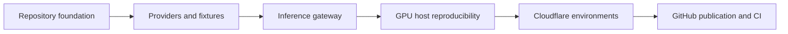

# Team Repository Program Implementation Plan

> **For agentic workers:** REQUIRED SUB-SKILL: Use superpowers:subagent-driven-development (recommended) or superpowers:executing-plans to implement this plan task-by-task. Steps use checkbox (`- [ ]`) syntax for tracking.

**Goal:** Deliver a cloneable Dimon team repository, GPU-free teammate workflow, authenticated shared inference, stable deployment, and safe GitHub publication.

**Architecture:** Execute six gated plans in dependency order. Each checkpoint must remain usable: first a clean local repository, then offline fixtures, then remote inference, then reproducible GPU hosting, then stable Cloudflare environments, and finally private GitHub collaboration followed by an approved public release.

**Tech Stack:** Python 3.12, uv, FastAPI, SQLite, llama.cpp, NVIDIA NeMo Speech, Kokoro, Cloudflare Tunnel/Access, GitHub Actions.

**Spec:** [Team repository and inference architecture design](../specs/2026-09-27-team-repository-and-inference-architecture-design.md)

## Global Constraints

- Keep model weights and compiled runtimes once on the GPU host and outside Git.
- Keep policy, receipts, approval, session isolation, and SQLite execution in the Dimon application.
- Default teammate development to deterministic fixtures.
- Keep raw model services private and expose only the bounded inference gateway to authenticated teammates.
- Preserve the personal llama and Jarvis projects and hostnames.
- Publish privately first; make the repository public only after a concrete audit and explicit user approval.

## Review Focus

- Do not begin a dependent plan until the preceding verification contract passes.
- Keep the application runnable at every checkpoint.
- Treat repository contents, Git history, gateway inputs, and Cloudflare routes as separate security boundaries.
- Record evidence from actual commands; do not replace validation with documentation claims.

---

## Ordered Checkpoints

1. [Repository foundation](2026-09-27-repository-foundation.md) — safe tracked-file boundary, root uv project, fresh Git history, and clean-clone proof.
2. [Inference providers and fixtures](2026-09-27-inference-providers-and-fixtures.md) — offline teammate feedback loop and one mode-selection boundary.
3. [Bounded inference gateway](2026-09-27-inference-gateway.md) — authenticated intent, transcription, and result-speech APIs plus Dimon's remote provider.
4. [GPU host reproducibility](2026-09-27-gpu-host-reproducibility.md) — project-owned manifests, launchers, lifecycle control, and shared/standalone host modes without duplicate weights.
5. [Cloudflare environments](2026-09-27-cloudflare-environments.md) — stable public, inference, and staging hostnames with Access and rollback checks.
6. [GitHub publication and CI](2026-09-27-github-publication-and-ci.md) — GPU-free CI, protected private collaboration, history audit, judge rehearsal, and approved public release.

## Dependency Graph

## Program Gates

- [ ] Gate 1: A fresh local clone installs from `uv.lock`, passes all existing tests, and contains no forbidden artifact.
- [ ] Gate 2: A teammate can run intent, voice, speech, approvals, and SQLite flows with all model services stopped.
- [ ] Gate 3: Remote mode passes the same provider contract through the authenticated bounded gateway.
- [ ] Gate 4: Shared and standalone host modes use one set of external artifacts and never alter personal services.
- [ ] Gate 5: All three Dimon hostnames pass routing, Access, WebSocket, CORS, and rollback rehearsals.
- [ ] Gate 6: The exact private release commit passes CI, history audit, teammate onboarding, and judge rehearsal.
- [ ] Gate 7: The user approves the concrete private release package before public visibility changes.

## Implementation Order Within a Hackathon

The critical teammate loop is checkpoints 1 and 2. Complete those first even if host deployment work is still pending. Checkpoint 3 enables shared live inference. Checkpoints 4 and 5 turn the owner's working machine into a reproducible integrated host. Checkpoint 6 should start with CI and private publication after checkpoint 2, then return for the final deployment evidence after checkpoint 5.

Do not collapse the fixture and live-inference paths: fixtures make daily team development reliable, while the remote gateway supplies integration evidence. Both are required for a workable hackathon repository.
